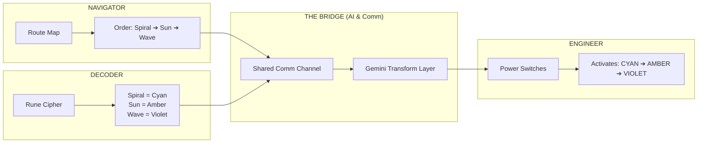

# GAP//BREAKERS — Rebuild Reality
## Official Hackathon Submission · Devlympics – Shunya 2026

**Event:** Google Developer Groups on Campus (GDG on Campus), Netaji Subhas University of Technology (NSUT)  
**Hackathon:** Devlympics — Shunya 2026  
**Problem Statement:** **Bridge the Gap**  
**Project Name:** GAP//BREAKERS — Rebuild Reality  
**Live URL (Local):** `http://localhost:3000`  
**Test Suite:** 33 / 33 Passing (`npm test`)  
**Production Build:** Verified with Next.js 15 & Turbopack (`npm run build`)  

---

## 🎯 Executive Summary & The Central Question

> ### *The Central Question:*
> **"Which two sides should be able to connect, and what could exist between them to make that possible?"**

### 1. The Two Sides:
- **Side A (Fragmented Human Minds):** Multiple collaborators separated by **information asymmetry** (different partial clues), **language barriers** (e.g. Hindi vs. English), and **divergent mental models** (abstract spatial thinkers vs. cryptographic pattern decoders vs. operational engineers).
- **Side B (Shattered Reality / The Failing System):** A physical and societal reality that is collapsing into the void because its vital infrastructure is split into disconnected islands.

### 2. What Exists Between Them (The Bridge):
An **adaptive cognitive translation engine & real-time synchronization framework** that bridges human communication gaps in three dimensions:
1. **Linguistic Bridge:** Dynamic Gemini-powered translation between languages.
2. **Cognitive Bridge:** AI message simplification, ASCII visual diagramming, and conceptual re-explanation that translates high-friction jargon into immediate action.
3. **Physical & Metaphorical Bridge:** As mutual human understanding is achieved, an energy bridge dynamically reconstructs across 3 observable stages, literally saving the floating world.

---

## 💡 How GAP//BREAKERS Meets the Prompt Rubric

| Prompt Criteria | The Problem Statement Guideline | How GAP//BREAKERS Solves It |
|---|---|---|
| **Theme** | *Create something that connects two sides separated by differences in knowledge, access, language, ability or technology.* | Players embody 3 asymmetric roles (Navigator, Decoder, Engineer). No single player has enough data to act alone. They must bridge their information, language, and role silos. |
| **Diversity of Gaps** | *Beginners and experts / complex info and ordinary users / different languages / different abilities.* | Built-in AI transform suite: <br>• `translate`: English ↔ Hindi translations.<br>• `simplify`: Distills complex lore into concise actions.<br>• `visualize`: Converts text into ASCII diagrams for visual learners.<br>• `explain_differently`: Uses intuitive real-world analogies. |
| **Creative Edge** | *The "gap" does not have to be a serious social problem... it could be informational or fictional. Redefine what it means to act as the bridge.* | The bridge is not just an interface — it is the **gameplay mechanic itself**. The visual bridge responds only to true collaborative events, creating a shared, visceral sense of reconnection. |

---

## 🧩 The Core Puzzle & Information Asymmetry

In **Mission 01: Save the Floating City**, three players must work together:



### The 3-Stage Dynamic Bridge Reconstruction:
1. **Stage 1 (Discovery):** Either Navigator or Decoder shares their primary clue $\rightarrow$ **Bridge Section 1 begins glowing**.
2. **Stage 2 (Understanding):** Both clues are shared and the Engineer acknowledges the sequence $\rightarrow$ **Bridge Section 2 physically reconstructs**.
3. **Stage 3 (Reconnection & Victory):** Engineer activates the exact sequence (`CYAN → AMBER → VIOLET`) $\rightarrow$ **Bridge Section 3 connects**, the energy core restores, and the city is saved.

---

## 🧮 Transparent Bridge Scoring Formula

GAP//BREAKERS rejects arbitrary or fabricated metrics. The post-mission report computes the **Bridge Score ($0 - 100$)** exclusively from observable game events:

$$\text{Bridge Score} = S_{\text{completion}} + S_{\text{restoration}} + S_{\text{collab}} + S_{\text{accuracy}}$$

- **Mission Completion ($S_{\text{completion}}$):** $40\text{ pts}$ if energy core restored; $0\text{ pts}$ if timer expired.
- **Bridge Restoration ($S_{\text{restoration}}$):** Up to $30\text{ pts}$ ($10\text{ pts}$ per repaired bridge section).
- **Active Collaboration ($S_{\text{collab}}$):** Up to $20\text{ pts}$ based on clues shared and AI clarifications requested.
- **Action Accuracy ($S_{\text{accuracy}}$):** Up to $10\text{ pts}$ ($10 - (\text{incorrect actions} \times 5)$, floor $0$).

---

## 🛠️ Architecture & Tech Stack

```
gap-breakers/
├── app/
│   ├── layout.tsx                    # Next.js App Router Root Layout
│   ├── page.tsx                      # Cinematic Landing Page + GDG Theme Spotlight
│   ├── setup/page.tsx                # Player Setup & Avatar Selection
│   ├── lobby/page.tsx                # Room Creation & Solo Practice Matchmaking
│   ├── game/[missionId]/page.tsx      # Real-Time Collaborative Gameplay Screen
│   ├── results/page.tsx              # Transparent Bridge Score & Event Analytics
│   └── api/
│       ├── ai/transform/route.ts     # Gemini 1.5 Flash Endpoint + Offline Fallback
│       ├── rooms/create/route.ts     # Multiplayer Room Provisioning
│       └── rooms/join/route.ts       # Room Code Validation
│
├── components/game/
│   ├── WorldScene.tsx                # SVG / Canvas Floating City & Living Bridge
│   ├── BridgeSection.tsx             # Animated Segment with Particle Shaders
│   ├── CluePanel.tsx                 # Role-Specific Clue Display
│   ├── ControlPanel.tsx              # Engineer's Tactile Switch Controls
│   ├── MessageFeed.tsx               # Comm Channel with AI Transform Actions
│   ├── TeamPanel.tsx                 # Real-Time Player Status & Roles
│   └── MissionTimer.tsx              # Synchronized Mission Countdown Ring
│
├── lib/
│   ├── game/
│   │   ├── state-machine.ts          # Pure Finite State Machine & Scoring Math
│   │   ├── missions.ts               # Puzzle Rules & Clue Dictionaries
│   │   └── roles.ts                  # Asymmetric Role Specifications
│   └── ai/
│       └── fallback.ts               # Zero-Dependency Context-Aware Offline AI
│
└── stores/
    └── gameStore.ts                  # Reactive Zustand State Store
```

---

## 🧪 Verification & Test Coverage

The project includes an automated test suite executed via Jest:
```bash
npm test
```

### Test Results: 33 Passed / 33 Total (100%)
- **Correct Sequence Validation:** Confirms `CYAN → AMBER → VIOLET` is required; rejects out-of-order activations.
- **Invalid Activation Prevention:** Ensures switches cannot be activated after victory or without preceding steps.
- **State Machine Transitions:** Verifies `idle → setup → discovery → understanding → solving → victory / failure`.
- **Bridge Monotonicity:** Ensures bridge sections never regress backwards once repaired.
- **Mathematical Scoring:** Verifies score uses only observable events with zero fabricated numbers.
- **Room Code Verification:** Validates 6-character room codes and sanitization.

---

## 🚀 Live Demonstration Walkthrough for Judges

1. **Visit Landing Page (`http://localhost:3000`):**
   - Review the floating islands, animated bridge preview, and "Bridge the Gap" problem statement breakdown.
2. **Click "ENTER THE RIFT":**
   - Choose your codename, avatar, and preferred language.
3. **Launch Solo Mode in the Lobby:**
   - Simulated teammates will join to demonstrate full asymmetric mechanics on a single device.
4. **Experience Role Perspectives:**
   - Switch between **Navigator**, **Decoder**, and **Engineer** using the top yellow perspective switcher.
   - Click **"Share Route Map"** as Navigator $\rightarrow$ Bridge Section 1 begins glowing.
   - Switch to **Decoder** and click **"Share Rune Table"** $\rightarrow$ Bridge Section 2 reconstructs.
   - Test an AI action on any message (**Simplify** or **Visualize**).
   - Switch to **Engineer** and click **CYAN**, then **AMBER**, then **VIOLET**.
5. **Inspect the Victory Screen & Results Report:**
   - Watch the bridge fully connect with particle resonance.
   - Inspect the mathematically transparent **Bridge Score** and event breakdown on `/results`.
